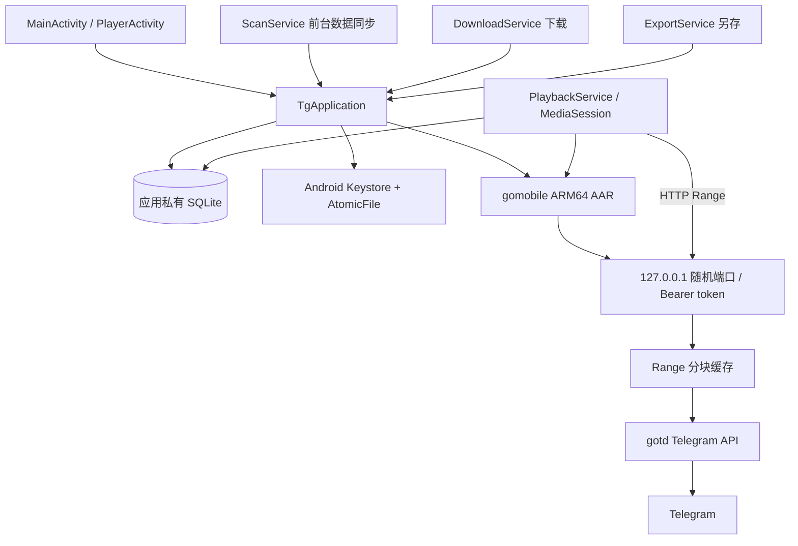

# TGProxy Android 技术说明

本文描述Android 0.7.0的模块职责、数据格式和生命周期约束。产品范围与操作流程见[README.md](README.md)；本轮优化结果见[验收报告](../docs/APP-OPTIMIZATION-20261115.md)，设备及发布验收见[VERIFICATION.md](VERIFICATION.md)。

## 运行结构

Android 工程位于 `android/`，使用 Kotlin、AppCompat、Material 3 和 Media3，由业务 `:app` 与可复用 `:player-controls` 两个 Gradle module 组成。`tgproxy/mobile/` 是独立 Go module，通过 gomobile 生成 ARM64 AAR；它复用父级 `tgproxy` module 中的 Telegram 客户端和 Range/cache 实现，但不启动服务器 Web 控制台、外部监听地址或 Jellyfin 集成。Go 依赖通过 mobile module 的 `replace` 指向项目维护的 gotd/td 和 TDL forks。

gotd/td 和 TDL 的相关 Go 库会编译进 AAR，手机无需另行安装它们的可执行程序。确切 fork 版本以 [mobile go.mod](../tgproxy/mobile/go.mod) 为准。

| 源码入口 | 职责 |
| --- | --- |
| [TgApplication.kt](app/src/main/java/dev/tgproxy/mobile/TgApplication.kt) | Engine、操作队列、扫描循环及本机账号管理 |
| [MediaDatabase.kt](app/src/main/java/dev/tgproxy/mobile/MediaDatabase.kt) | SQLite schema、迁移、频道事务和查询 |
| [SessionVault.kt](app/src/main/java/dev/tgproxy/mobile/SessionVault.kt) | Keystore 加密与授权文件原子写入 |
| [ScanService.kt](app/src/main/java/dev/tgproxy/mobile/ScanService.kt) | 索引前台服务与暂停动作 |
| [ChannelScanQueue.kt](app/src/main/java/dev/tgproxy/mobile/ChannelScanQueue.kt) / [ChannelIndexer.kt](app/src/main/java/dev/tgproxy/mobile/ChannelIndexer.kt) | 串行任务、逐频道结果及页级断点提交 |
| [ChannelUpdateButton.kt](app/src/main/java/dev/tgproxy/mobile/ChannelUpdateButton.kt) | 小图标、点击区域与动画生命周期 |
| [PlaybackService.kt](app/src/main/java/dev/tgproxy/mobile/PlaybackService.kt) | ExoPlayer、MediaSession 和媒体鉴权 |
| [PlayerActivity.kt](app/src/main/java/dev/tgproxy/mobile/PlayerActivity.kt) | 播放控制器、界面和音轨诊断 |
| [PlaybackHistory.kt](app/src/main/java/dev/tgproxy/mobile/PlaybackHistory.kt) / [PlaybackCatalog.kt](app/src/main/java/dev/tgproxy/mobile/PlaybackCatalog.kt) | 同媒体观看记录、播放范围与分页选片 |
| [Downloads.kt](app/src/main/java/dev/tgproxy/mobile/Downloads.kt) / [DownloadStore.kt](app/src/main/java/dev/tgproxy/mobile/DownloadStore.kt) | 下载调度、状态快照和独立下载库 |
| [Exports.kt](app/src/main/java/dev/tgproxy/mobile/Exports.kt) / [ExportStore.kt](app/src/main/java/dev/tgproxy/mobile/ExportStore.kt) | 文件提供器复制、取消及持久导出记录 |
| [Go 手机接口](../tgproxy/mobile/index.go) | 频道枚举、单页扫描与按需视频注册 |
| [Telegram 索引适配](../tgproxy/internal/telegram/mobile_index.go) | dialogs 枚举、历史页提取与原始消息游标 |

`TgApplication`持有一个`Engine`、媒体索引／下载／导出的SQLite helpers、Keystore vault和单线程操作executor。登录、频道枚举和扫描等会改变Telegram client状态的操作进入该executor，完成后在主线程回调UI；下载、导出和播放媒体查询分别使用独立队列。播放HTTP请求独立运行于Go内置loopback server。

## 登录和凭证

UI 提交手机号、验证码及可选两步验证密码给 Go `Engine`。Go Telegram client 通过 auth send-code/sign-in/password 流程建立用户 session。Telegram 登录验证码与 API ID/Hash 是两组不同信息：手机号和验证码标识用户，API 凭证标识调用 Telegram API 的客户端应用。

API ID/Hash 可选且必须成对出现。未填写时 Go `NewEngine` 使用父 module 的 `config.Defaults()` 预设值；填写时 Android 检查 API ID 范围及 32 位十六进制 Hash，Go 核心再次校验。填写凭证会替换当前 Engine，并写入本机 vault。公开分发前应使用开发者在 `my.telegram.org` 申请的凭证。

`SessionVault` 把凭证和序列化 session 一起编码为 JSON，再使用 Android Keystore 中的 AES key 通过 AES/GCM/NoPadding 加密。文件由 `AtomicFile` 写入应用 `noBackupFilesDir`；IV 与密文连接保存。Manifest 禁用系统备份。登出会停止播放、关闭 Go Engine、清除 vault 和 SQLite 账号数据。

## Go / gomobile 边界

Android 与 Go 之间只暴露 gomobile 支持的简单参数和返回值。复杂结构以 JSON 字符串传递，不把 Go context、peer、Telegram TL 类型或内部 `ChunkSource` 暴露给 Kotlin。

主要的 Android 入口包括：

- `NewEngine(appID, appHash, session)`：创建 Telegram client、回环 HTTP listener、Range cache 和随机媒体 token；有 session 时启动自动重连。
- `SendCode`、`SignIn`、`SubmitPassword`：登录流程；错误被映射为可显示的稳定提示，不输出敏感异常堆栈。
- `ListChannels`：从 Telegram dialogs 枚举主列表及归档，过滤已退出、min 或非频道对话，并按 ID 去重。
- `FindChannel(ref)`：解析公开链接、用户名或数字 ID，返回不含 access hash 的展示数据。
- `ScanPage(channelID, offsetID, minID)`：读取一页最多 100 条原始消息，返回视频条目、最小消息 ID、页内最大消息 ID 和完成标志。
- `RegisterVideo(payload)` / `PlaybackURL(key)`：按需把所选视频元数据加入 Engine 的内存 map，并生成本机播放 URL。Engine 重启后 UI 数据库仍保存完整索引，无需在启动时截断恢复 1000 条。

Go video key 为 `<channel_id>_<message_id>`。真正下载媒体时，Go 使用当前授权和已解析 peer，再通过 `ChunkFile` / `ChunkSource` 按范围读取；数据库只保存定位所需的频道 ID、消息 ID 和视频元数据，不保存 Telegram 文件 URL 或 access hash。

## 索引与游标

`ScanService` 以 `dataSync` foreground service 运行，顶部更新请求将当时已添加的频道组成串行队列；单频道、历史和校验使用同一入口。`ChannelScanQueue` 保存独立的批次和逐频道状态；一个频道失败不会阻断其他项，取消会停止后续项。整批只调用一次 `PrepareScan`，不能在频道切换时重置取消标记。队列只在进程内，SQLite 断点持久保留。通知提供暂停和返回频道页。Android 13+ 首次启动前请求通知权限。

`ChannelIndexer` 隔离页读取与数据库事务。首次更新无水位的频道只读最新一页，以历史分支保存 `latest_id/history_offset`，之后更新追新增，较早内容由历史扫描补齐。每页 `applyPage` 返回事务内频道计数的增量，重复 key 不算新增。暂停仍提交已完整返回的一页；失败不推进游标。Go 单页 RPC 有 60 秒 timeout。

每个频道的 JSON payload 保存独立状态：

- `history_offset`：向旧消息方向扫描时，最后已提交页内所有原始消息的最小 ID。0 表示从频道最新消息开始。
- `history_done`：历史接口返回空页后置为 true。
- `latest_id`：已完整覆盖的新消息高水位。
- `refresh_offset` / `refresh_base` / `refresh_target`：新增同步期间的独立分页游标、开始扫描时的旧水位以及本次观察到的目标最高 ID。刷新未完成前不推进 `latest_id`。
- `updated`：最后一次成功提交的 Unix 毫秒时间。

扫描游标基于原始消息而不是“视频条目”：一页可能含服务消息、空消息或其他非视频内容。Go 每页用原始消息最小 ID 推进，视频提取只影响 `items`，避免暂停后跳过非视频消息之间的旧视频。刷新接口以 `MinID` 限定旧高水位以后的消息；一轮刷新完成后才提交新的高水位。

SQLite 每页事务原子写入视频和频道 payload。只有成功提交整页后才请求下一页。移除频道会在同一事务删除该频道的视频、频道元数据和对应 playback rows，不影响其他频道。Page 的 video key、channel ID 和 message ID 在插入时再次校验。

## SQLite schema

媒体索引数据库版本为4，开启WAL。v2→v3新增`metadata`保存索引账号归属；v3→v4只重建／增加排序索引，保留视频、频道和观看数据。日期升降序、名称、频道内日期／名称／主键和观看时间均有对应索引。

| 表 | 主要列 | 用途 |
| --- | --- | --- |
| `channels` | `id`、`payload` | 频道引用、展示信息、历史/增量游标和更新时间 |
| `videos` | `key`、`channel_id`、`name`、`payload`、`date` | 本地检索与 Telegram 消息定位；按日期、频道建索引 |
| `playback` | `key`、`position`、`updated` | 逐视频恢复位置及最近播放排序 |
| `metadata` | `key`、`value` | 已核实的 Telegram 账号 ID |

首次数据库版本为 1：视频行不带 `channel_id`，频道表固定使用 `id=1`，播放表只有 key 和 position。升级到 v2 时通过 ALTER TABLE 保留原行，逐个解析现有 video payload 写入 channel ID；从旧频道 payload 迁移频道展示数据；已知视频中的最小、最大消息 ID 分别作为初始历史游标和最新高水位。播放位置保留，新增 `updated` 列默认 0。迁移不依赖 SQLite JSON extension，也不销毁旧数据。

空搜索不执行LIKE；非空搜索仍通过参数绑定和`LIKE ... ESCAPE`按字面子串匹配，反斜线、百分号和下划线视为普通文字。每页最多50条，额外读取一条判断下一页。`VideoPageCursor`保存排序值和唯一key，日期／名称／观看时间的同值条目按key处理，向后分页无需跳过全部前页；缺失旧页游标时允许OFFSET回退。指定频道生成独立`channel_id=?`条件以使用索引。最近播放默认按观看时间排序，也可选择发布时间或名称；数据减少导致越界时回到第一页，退出账号清空旧筛选和页码。

## Range 播放和 MediaSession

Go Engine 只在 `127.0.0.1` 的动态 TCP 端口监听。每次 Engine 创建时用 `crypto/rand` 生成 token；HTTP middleware 在路由和媒体解析前以常量时间比较校验 `Authorization: Bearer ...`。端口不对局域网开放，状态接口不包含 token。

Android `PlaybackService` 持有 ExoPlayer 和 MediaSession，负责音频焦点、耳机拔出处理、网络唤醒和每 5 秒将播放进度交给后台队列保存，事务内核对文档 ID 和账号归属；换片、删除、换账号后不能写回旧断点。`PlayerActivity` 通过 MediaController 连接 service；页面停止时释放 controller，不释放 service player。普通停止会清空 media item 并停止 service；退出账号会额外封锁并释放 session，避免旧 session 在 Engine 关闭后继续请求媒体。

MediaSession callback 只接受同 application UID 的 controller。App 使用 `OPEN` 自定义 SessionCommand 传入索引 key，服务在后台读取 SQLite payload、向 Go 注册视频，再生成本机 URL；成功后才在主线程准备播放，失败以 SessionResult 返回页面。打开请求使用代次和 Engine 身份校验，停止／换账号／后发请求使旧结果失效。明确播放同一媒体时恢复暂停、结束或错误；生命周期重绑保持原有状态。页面不会将旧视频当作失败的目标资源展示。调用者不能直接指定 URI，因此不会把认证 header 转发至任意服务器。认证 header 只配置到 Media3 使用的本机 HTTP data source。

Go Range 缓存采用 512 KiB chunk、64 MiB LRU 容量、3 个顺序预取块；同一 source resolution 缓存 1 分钟，最多 32 项。Android 使用 Media3 `DefaultHttpDataSource`/ExoPlayer 读取本机流。服务按请求范围取流，支持跳播，无需先下载完整视频。

`QUEUE`与`OPEN`同样限制同UID。`PlaybackCatalog`沿用频道、名称／日期排序和搜索范围，索引选片最终打开时再次优先同document的完成文件；下载管理只查询该账号的本机完成项。文字选片每页50项。连续播放默认关闭，服务在ENDED时查询下一条；暂停、换片、换账号和新请求撤销迟到的自动切换／恢复。

页面为每次明确选片生成UUID，服务在成功接受后保留最近32个兑现标记。Activity解绑后即使丢失OPEN回调，重绑仍可识别该选择已完成并跟随后台下一条；标记随服务停止清空。同document切换在线／本机来源时继承即时位置，已ENDED使用0从头重播。`PlaybackRetryPolicy`对终止网络错误使用1／2／4秒退避、最多三次，并尊重最多30秒的数字Retry-After；稳定播放10秒重置次数，权限、换片和解码错误不自动恢复。

## 可复用播放控制

`player-controls` 仅依赖 Android UI 和 Media3 Player 接口，可接收 MediaController 或 ExoPlayer。它复用官方 PlayerView、进度条、播放按钮和音轨/字幕菜单，补充倍速／比例底部面板、手势、锁定与偏好。模块不读取 Telegram、SQLite、媒体 URL 或 token，详情见 [接入说明](player-controls/README.md) 与 [选型依据](player-controls/DECISION.md)。

长按期间的 2× 不写入偏好；松手、ACTION_CANCEL、多指取消、失焦、旋转、锁定、解绑和宿主停止均结束临时手势。亮度仅改 Window，进入后台恢复原值；媒体音量按累计位移修改系统 STREAM_MUSIC。宿主先调用 onHostStop，再解绑并释放 MediaController，后台 ExoPlayer 保持原有服务所有权。

## 界面与本地状态

`MainActivity` 采用 BottomNavigationView、TextInputLayout 和分隔式纯文字媒体列表，不显示页面标题／副标题。视频目的地把搜索和筛选放在 `videoHeader` 固定区；主 `ScrollView` 只承载视频结果列表。查询由独立 executor 执行；结果回到主线程前比对请求编号与容器身份，防止切换页面后的旧查询写入新页面。列表每页 50 条，频道数量使用单次 GROUP BY 聚合。滚动位置在异步列表填充后恢复，翻页显式回到顶部。

`document_id` 是非凭据的文档身份，校验换片和保存断点使用它；不向 Android 传 access hash 或 file reference。`date` 使用 Telegram 消息 Unix 秒，`MediaPresentation` 按设备时区格式化；列表显示日期，`VideoDetailActivity` 显示完整时间，非法或缺失值隐藏，无需 schema 迁移。排序参数映射到固定 SQL 片段，不能插入任意 SQL。首页直接显示资源列表；最近播放包含未完成及已完成记录，详情仍可根据保存的断点续播。详情只接收主键，不接收媒体 URL，读取和同频道查询在后台完成；频道数量统计也不在主线程执行。

搜索、频道筛选、页码、目的地和频道输入草稿保存在 Activity 状态中。添加频道改用底部面板，关闭或切换页面仍保留草稿。API ID/Hash、验证码和两步验证密码仅在进程内保留，通过非配置实例在主题变化、旋转时恢复；不写入系统保存状态。凭证展开/收起只切换区域可见性，保留输入控件与焦点。密码变换器在单行设置后应用，防止单行变换覆盖密码遮蔽。

外观选择存于应用私有 SharedPreferences，由 `TgApplication` 启动时调用 AppCompatDelegate 应用。扫描反馈使用频道行与更新按钮，不显示全局扫描卡片／加载条。`ChannelUpdateButton` 只旋转 18dp 图形，停止、切页、切后台或脱离窗口时取消动画；重建后从队列恢复。通知和频道按钮提供暂停入口，底部频道导航圆点表示仍有任务。授权失效时重新授权保留数据库；通过服务端 Self 身份核验当前用户 ID 与索引归属，账号不一致时阻止播放／扫描并提示重新登录原账号或显式退出。旧版没有归属记录时，仍有效的旧会话可自动完成一次绑定；旧会话已失效时需用户明确确认当前账号为原账号后才绑定旧索引。显式退出仍会清空本机账号数据和浏览条件。损坏会话在 Go 初始化前校验结构与密钥完整性，Android 提供重置授权入口；两步验证识别 gotd sentinel，登录超时回到手机号页且验证码／密码页可重新开始。

## 构建、包名和签名

Gradle 配置固定 compile/target SDK 36、min SDK 26、JDK 17、Kotlin JVM target 17、Media3 1.11.1 和 ABI `arm64-v8a`。`build-core.sh` 固定 gomobile 版本 `v0.0.0-20261011034528-197770444867`，通过 `gomobile bind -target=android/arm64 -androidapi=26` 生成本地 AAR。

- Debug application ID：`dev.tgproxy.mobile.poc`，名称 `TGProxy 验证`。
- Release application ID：`dev.tgproxy.mobile`，名称 `TGProxy`。
- Release 输出：`app/build/outputs/apk/release/tgproxy-android-arm64.apk`。

`build-release.sh` 创建本地 PKCS#12 keystore 和随机密码文件（umask 077），构建 AAR 和 Release，运行 zipalign、apksigner sign/verify 并输出 SHA-256。`.signing/` 被 Git 忽略。该签名用于当前本地安装；若要让用户跨发布版本升级，必须备份并持续复用相同签名密钥。

## 测试范围

`tgproxy/mobile/engine_test.go` 覆盖回环认证、跨 chunk Range 内容一致性、伪造 key 拒绝、无效 session 与可选凭证配对校验。`tgproxy/internal/telegram/mobile_index_test.go` 覆盖原始消息游标、短页与非视频消息和 RPC 失败。Android instrumentation 覆盖 Keystore 密文、SQLite v1→v2 迁移、多频道页事务、特殊字符搜索、暂停边界、播放器快进/后台和登录页面。

真实 Telegram 测试需要显式传 `liveTelegram=true`。它读取已登录账号的 dialogs 和消息页，并用既有索引播放视频。禁止在测试中输出真实频道名、文件名、手机号、session、播放 URL 或 token。真实扫描暂停/续扫会改变测试账号本地索引，运行前应明确目标频道。

`ChannelScanQueueTest` 使用假执行器覆盖串行、去重、重复启动拒绝、失败后继续、暂停队列和重试；`ChannelIndexerTest` 使用独立 SQLite 与假页验证首次一页、重复视频计数和双向游标。`ChannelUpdateUiTest` 只发布内存任务状态，验证动画、后台停止、重建、暂停和失败反馈，前后比对真实频道与索引总数不变。`ChannelUpdateLiveTest` 同样需显式传 `liveTelegram=true`，会通过页面按钮更新全部现有频道，再验证重建后的单频道更新，真实追加索引但不运行全量历史扫描。

## 已知边界

- 当前只构建和验证 ARM64 手机 ABI。
- Debug 和 Release 使用不同 UID，包数据和 Keystore 密钥彼此隔离；Release 首次登录。
- App 预设 API ID/Hash 只用于私下验证，不应作为公开发行应用凭证。
- 当前显式迁移保留索引v1→v4／v3→v4及下载v1→v2数据；未来schema变化继续添加迁移，不能清库替代。
- 前台索引受 Android foreground-service 配额和系统终止策略限制；页事务游标保证可续扫，但不保证后台无限运行。
- 音轨识别能报告已发现和已选择的音轨，不保证所有 Telegram 视频容器、编码和设备解码器都兼容。

## 资源校验与诊断

频道菜单提供“校验已索引资源／继续校验已索引资源”。先刷新频道标题，再按本机 key 游标每批读取最多 100 个已索引消息 ID，用 `channels.getMessages` 核查当前资源；不会因此向频道写入内容。仅成功且完整的结果可提交：更新仍为视频的条目，移除明确 MessageEmpty 或已变成非视频的条目。未知、不精确、漏 ID、重复或权限／网络错误整批失败，保留原索引。每批变化与 `recheck_key` 在同一事务提交；取消和重启可续验，完整结束后清游标并记录 checked 时间。普通新增同步继续使用原独立水位。

同一 message key 的 document ID 改变时清理旧断点；播放器保存进度也校验 document ID，避免活跃旧播放器写回。Go 解析缓存失效，分块仍按 document identity 分隔。已有流不会把新文档字节拼入旧文档缓存。

Go chunkSource 共享有效 DC／location 与版本；过期引用刷新合并并发请求，迁移与引用恢复交错时合并结果。等待恢复和数字频道解析锁的请求可被 context 取消。扫描取消标记在页间保留，只有新任务 PrepareScan 重置。注册媒体元数据限近期 128 条；本地测试素材使用内容身份作为缓存键。

主连接事件区分已授权与当前在线状态，内部重连期间对外报告 reconnecting。“我的 → 运行诊断”提供两秒采样下载速度、LRU 缓存量、命中／未命中、分块失败分类、连接重试、文件引用刷新和 DC 迁移次数；不显示 session、token、真实媒体 URL 或原始错误。缓存量仅指 LRU，不代表整个进程内存。

本轮测试覆盖及未验证范围见 VERIFICATION.md。还没有 Telegram updates 实时对账、自动定时校验、全视频编码覆盖或长期功耗结论。

## 持久下载与离线播放

`DownloadStore`独立维护schema2的`downloads.db`，保存任务UUID、原账号ID、视频快照、document、状态、字节数、position和watched。v1→v2保留原断点，未知观看时间记0；媒体索引schema为4。下载不随移除频道或退出账号清空。文件路径只由校验过的UUID生成，保存到`filesDir/downloads/`。写入`.part`，完整长度验证、fsync和改名后才标记COMPLETE；启动恢复处理中任务为PAUSED，并识别“已改名但状态未提交”的中断窗口。损坏记录和删除失败逐条隔离，坏UUID只删除数据库行，不猜测文件路径。

`Downloads` 使用独立命令与传输线程，串行下载，不占用登录／扫描操作队列或 Media3 播放器。命令、进度和最终提交共享锁；暂停关闭当前 HTTP 连接，取消删除等待写入者结束，避免迟到回调恢复已删除任务。元数据快照供页面与通知读取，不在每次 UI 刷新时扫描 SQLite。进程退出不自动继续，用户点击后启动 `DownloadService` 的 dataSync 前台服务，提供通知和有超时上限的 CPU 唤醒锁；系统服务时限或服务退出保存暂停状态。

`DownloadTransfer` 每次请求 1 MiB Range，检查 206、Content-Range 起止／总长及 ETag。Go ETag 来自实际 source CacheKey（Telegram document ID 和大小），If-Match 不符时返回 412；断点旁保存 ETag，首次请求也核对索引中的 document ID。相同消息换片且大小相同也不能拼接。HTTP 禁止跳转，Bearer 只向当前 Engine 的回环地址发送；URL 和令牌不持久化。重新授权／退出会暂停任务，每段及结束时验证 Engine 和账号身份，继续下载只能使用原账号。

下载完成后通过`download:<UUID>`发送受信任OPEN；PlaybackService验证完成状态和长度后建立file URI。离线播放与通知恢复不要求Telegram Engine。`PlaybackHistory`按同账号、key和document核对身份，比较两来源的观看时间；看完归零仍算新记录。在线进度同步同一完成文件，离线观看在当前索引仍属于该账号与document时同步最近播放，退出账号后仍独立保存本机断点。另一数据库暂不可读时继续采用当前来源的断点。

`Downloads`的初始化和调度外层统一收尾，异常后可以重新读取并启动；`DownloadStoragePolicy`为断点和SQLite预留16MiB，剩余空间不足时暂停整批。批量继续／失败重试只恢复原账号的有效记录。`DownloadSnapshot`在后台维护状态、统计和身份索引，进度用`SingleItemList`更新当前记录，不反复读取完整JSON历史；页面改为RecyclerView／ListAdapter，每批50行并只刷新当前可见下载。

## 持久另存与取消

`DownloadsActivity`通过ACTION_CREATE_DOCUMENT获得目标URI和实际读写授权，交给应用级`Exports`。`ExportStore`的独立`exports.db` schema1保存导出UUID、下载UUID、账号／document、URI、状态、字节数、touched、persisted和创建时间；复制按rowid入队顺序串行执行，历史每页50条。

启动将QUEUED／RUNNING／CANCELLING恢复为INTERRUPTED，保留结果并要求重新选位置。目标先查询SIZE确认空文件，再用`openFileDescriptor("wt", CancellationSignal)`复制；已有内容或无法确认空目标时拒绝覆盖。`ExportTransfer`用64KiB缓冲检查完整源长度、节流进度，并独立保留已完整写入块的字节数。完成提交与取消共用锁，流和FD在finally关闭；独立关闭线程避免提供器延迟阻塞页面。

`ExportService`使用dataSync前台服务、通知取消和有时限的唤醒锁。通知取消产生新的startId，空闲回调使用最新编号停止并释放锁；系统超时立即停止服务。服务停止通过全表SQL标记未完成任务，不受历史页上限限制，迟到的旧lease不能暂停新任务。

只有系统实际返回持久授权时才takePersistableUriPermission，mode仅包含获授的READ／WRITE。失败、取消或中断不自动删除目标；用户确认清理后再次检查终态、touched、活动写入者和其他导出引用，避免删除正在使用的副本。另存副本独立于下载任务，不申请全盘权限。本轮真实SAF验收覆盖POCO的本机Download提供器；云提供器即时取消及长期后台行为另需验证。

官方依据：[dataSync 前台服务](https://developer.android.com/develop/background-work/services/fgs/service-types#data-sync)、[系统文件创建与导出](https://developer.android.com/training/data-storage/shared/documents-files#create-file)。后台运行受系统限制，无法保证无限持续下载；网络中断失败后保留断点，由用户重试。播放与下载共享 Telegram 网络和带宽，当前下载并发为 1。

测试分层：JVM 本机 HTTP 测试截断续传、取消、Range 忽略和身份变化；Go stream race 测试 ETag/If-Match 拒绝同大小换片；Android 独立 SQLite／空会话 Engine 验证完整字节、数据库重开、改名恢复、失败隔离和离线播放。`DownloadLiveTest` 必须显式 `liveTelegram=true`，会从真实资源中取样验证启动／暂停／继续，只清理该用例创建的任务。
