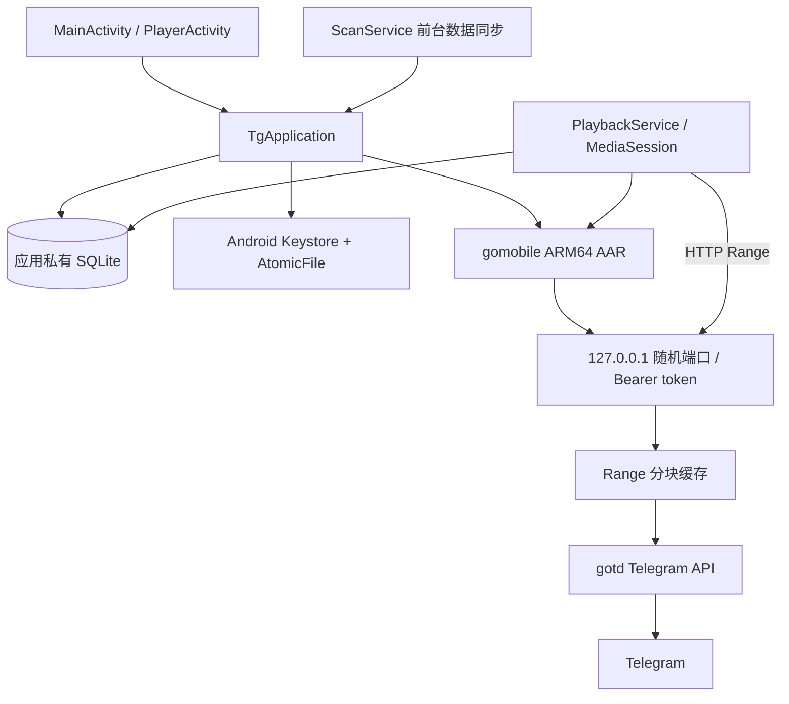

# TGProxy Android 技术说明

本文描述 Android 0.4.0 的模块职责、数据格式和生命周期约束。产品范围与操作流程见 [README.md](README.md)；设备和构建验收结果见 [VERIFICATION.md](VERIFICATION.md)。

## 运行结构

Android 工程位于 `android/`，使用 Kotlin、AppCompat、Material 3 和 Media3，由业务 `:app` 与可复用 `:player-controls` 两个 Gradle module 组成。`tgproxy/mobile/` 是独立 Go module，通过 gomobile 生成 ARM64 AAR；它复用父级 `tgproxy` module 中的 Telegram 客户端和 Range/cache 实现，但不启动服务器 Web 控制台、外部监听地址或 Jellyfin 集成。Go 依赖通过 mobile module 的 `replace` 指向项目维护的 gotd/td 和 TDL forks。

gotd/td 和 TDL 的相关 Go 库会编译进 AAR，手机无需另行安装它们的可执行程序。确切 fork 版本以 [mobile go.mod](../tgproxy/mobile/go.mod) 为准。

| 源码入口 | 职责 |
| --- | --- |
| [TgApplication.kt](app/src/main/java/dev/tgproxy/mobile/TgApplication.kt) | Engine、操作队列、扫描循环及本机账号管理 |
| [MediaDatabase.kt](app/src/main/java/dev/tgproxy/mobile/MediaDatabase.kt) | SQLite schema、迁移、频道事务和查询 |
| [SessionVault.kt](app/src/main/java/dev/tgproxy/mobile/SessionVault.kt) | Keystore 加密与授权文件原子写入 |
| [ScanService.kt](app/src/main/java/dev/tgproxy/mobile/ScanService.kt) | 索引前台服务与暂停动作 |
| [PlaybackService.kt](app/src/main/java/dev/tgproxy/mobile/PlaybackService.kt) | ExoPlayer、MediaSession 和媒体鉴权 |
| [PlayerActivity.kt](app/src/main/java/dev/tgproxy/mobile/PlayerActivity.kt) | 播放控制器、界面和音轨诊断 |
| [Go 手机接口](../tgproxy/mobile/index.go) | 频道枚举、单页扫描与按需视频注册 |
| [Telegram 索引适配](../tgproxy/internal/telegram/mobile_index.go) | dialogs 枚举、历史页提取与原始消息游标 |

`TgApplication` 持有一个 `Engine`、一个 SQLite helper、Keystore vault 和单线程操作 executor。登录、频道枚举和扫描等会改变 Telegram client 状态的操作进入该 executor，完成后在主线程回调 UI。播放 HTTP 请求独立运行于 Go 内置 loopback server。

## 登录和凭证

UI 提交手机号、验证码及可选两步验证密码给 Go `Engine`。Go Telegram client 通过 auth send-code/sign-in/password 流程建立用户 session。Telegram 登录验证码与 API ID/Hash 是两组不同信息：手机号和验证码标识用户，API 凭证标识调用 Telegram API 的客户端应用。

API ID/Hash 可选且必须成对出现。未填写时 Go `NewEngine` 使用父 module 的 `config.Defaults()` 预设值；填写时 Android 检查 API ID 范围及 32 位十六进制 Hash，Go 核心再次校验。填写凭证会替换当前 Engine，并写入本机 vault。公开分发前应使用开发者在 `my.telegram.org` 申请的凭证。

`SessionVault` 把凭证和序列化 session 一起编码为 JSON，再使用 Android Keystore 中的 AES key 通过 AES/GCM/NoPadding 加密。文件由 `AtomicFile` 写入应用 `noBackupFilesDir`；IV 与密文连接保存。Manifest 禁用系统备份。登出会停止播放、关闭 Go Engine、清除 vault 和 SQLite 账号数据。

## Go / gomobile 边界

Android 与 Go 之间只暴露 gomobile 支持的简单参数和返回值。复杂结构以 JSON 字符串传递，不把 Go context、peer、Telegram TL 类型或内部 `ChunkSource` 暴露给 Kotlin。

主要的 Android 入口包括：

- `NewEngine(appID, appHash, session)`：创建 Telegram client、回环 HTTP listener、Range cache 和随机媒体 token；有 session 时启动自动重连。
- `SendCode`、`SignIn`、`SubmitPassword`：登录流程；错误被映射为可显示的稳定提示，不输出敏感异常堆栈。
- `ListChannels`：从 Telegram dialogs 枚举主列表及归档，过滤已退出、min 或非频道对话，并按 ID 去重。
- `FindChannel(ref)`：解析公开链接、用户名或数字 ID，返回不含 access hash 的展示数据。
- `ScanPage(channelID, offsetID, minID)`：读取一页最多 100 条原始消息，返回视频条目、最小消息 ID、页内最大消息 ID 和完成标志。
- `RegisterVideo(payload)` / `PlaybackURL(key)`：按需把所选视频元数据加入 Engine 的内存 map，并生成本机播放 URL。Engine 重启后 UI 数据库仍保存完整索引，无需在启动时截断恢复 1000 条。

Go video key 为 `<channel_id>_<message_id>`。真正下载媒体时，Go 使用当前授权和已解析 peer，再通过 `ChunkFile` / `ChunkSource` 按范围读取；数据库只保存定位所需的频道 ID、消息 ID 和视频元数据，不保存 Telegram 文件 URL 或 access hash。

## 索引与游标

`ScanService` 以 `dataSync` foreground service 运行，通过通知显示频道名和暂停动作。Android 13+ 首次启动该服务前请求通知权限。系统服务时限、用户暂停或进程中止时，已提交页面仍保留；下次任务按 SQLite 中的游标继续。Go 单页 RPC 有 60 秒 timeout，Kotlin 在一页完整返回后提交事务再请求下一页。

每个频道的 JSON payload 保存独立状态：

- `history_offset`：向旧消息方向扫描时，最后已提交页内所有原始消息的最小 ID。0 表示从频道最新消息开始。
- `history_done`：历史接口返回空页后置为 true。
- `latest_id`：已完整覆盖的新消息高水位。
- `refresh_offset` / `refresh_base` / `refresh_target`：新增同步期间的独立分页游标、开始扫描时的旧水位以及本次观察到的目标最高 ID。刷新未完成前不推进 `latest_id`。
- `updated`：最后一次成功提交的 Unix 毫秒时间。

扫描游标基于原始消息而不是“视频条目”：一页可能含服务消息、空消息或其他非视频内容。Go 每页用原始消息最小 ID 推进，视频提取只影响 `items`，避免暂停后跳过非视频消息之间的旧视频。刷新接口以 `MinID` 限定旧高水位以后的消息；一轮刷新完成后才提交新的高水位。

SQLite 每页事务原子写入视频和频道 payload。只有成功提交整页后才请求下一页。移除频道会在同一事务删除该频道的视频、频道元数据和对应 playback rows，不影响其他频道。Page 的 video key、channel ID 和 message ID 在插入时再次校验。

## SQLite schema

数据库版本为 2，开启 WAL。

| 表 | 主要列 | 用途 |
| --- | --- | --- |
| `channels` | `id`、`payload` | 频道引用、展示信息、历史/增量游标和更新时间 |
| `videos` | `key`、`channel_id`、`name`、`payload`、`date` | 本地检索与 Telegram 消息定位；按日期、频道建索引 |
| `playback` | `key`、`position`、`updated` | 逐视频恢复位置及最近播放排序 |

首次数据库版本为 1：视频行不带 `channel_id`，频道表固定使用 `id=1`，播放表只有 key 和 position。升级到 v2 时通过 ALTER TABLE 保留原行，逐个解析现有 video payload 写入 channel ID；从旧频道 payload 迁移频道展示数据；已知视频中的最小、最大消息 ID 分别作为初始历史游标和最新高水位。播放位置保留，新增 `updated` 列默认 0。迁移不依赖 SQLite JSON extension，也不销毁旧数据。

搜索使用参数绑定，并转义反斜线、百分号和下划线后交给 `LIKE ... ESCAPE`，文件名中的这些字符按普通文字匹配。每页最多展示 50 条，额外读取一条用于判断是否有下一页。

## Range 播放和 MediaSession

Go Engine 只在 `127.0.0.1` 的动态 TCP 端口监听。每次 Engine 创建时用 `crypto/rand` 生成 token；HTTP middleware 在路由和媒体解析前以常量时间比较校验 `Authorization: Bearer ...`。端口不对局域网开放，状态接口不包含 token。

Android `PlaybackService` 持有 ExoPlayer 和 MediaSession，负责音频焦点、耳机拔出处理、网络唤醒和每 5 秒保存播放进度。`PlayerActivity` 通过 MediaController 连接 service；页面停止时释放 controller，不释放 service player。普通停止会清空 media item 并停止 service；退出账号会额外封锁并释放 session，避免旧 session 在 Engine 关闭后继续请求媒体。

MediaSession callback 只接受同 application UID 的 controller。controller 传入 `mediaId`，服务从 SQLite 读取 payload、向 Go 注册视频，再生成本机 URL。调用者不能直接指定 URI，因此不会把认证 header 转发至任意服务器。认证 header 只配置到 Media3 使用的本机 HTTP data source。

Go Range 缓存采用 512 KiB chunk、64 MiB LRU 容量、3 个顺序预取块；同一 source resolution 缓存 1 分钟，最多 32 项。Android 使用 Media3 `DefaultHttpDataSource`/ExoPlayer 读取本机流。服务按请求范围取流，支持跳播，无需先下载完整视频。

## 可复用播放控制

`player-controls` 仅依赖 Android UI 和 Media3 Player 接口，可接收 MediaController 或 ExoPlayer。它复用官方 PlayerView、进度条、播放按钮和音轨/字幕菜单，补充倍速／比例底部面板、手势、锁定与偏好。模块不读取 Telegram、SQLite、媒体 URL 或 token，详情见 [接入说明](player-controls/README.md) 与 [选型依据](player-controls/DECISION.md)。

长按期间的 2× 不写入偏好；松手、ACTION_CANCEL、多指取消、失焦、旋转、锁定、解绑和宿主停止均结束临时手势。亮度仅改 Window，进入后台恢复原值；媒体音量按累计位移修改系统 STREAM_MUSIC。宿主先调用 onHostStop，再解绑并释放 MediaController，后台 ExoPlayer 保持原有服务所有权。

## 界面与本地状态

`MainActivity` 采用 BottomNavigationView、TextInputLayout 和分隔式纯文字媒体列表，不显示页面标题／副标题。视频目的地把搜索和筛选放在 `videoHeader` 固定区；主 `ScrollView` 只承载视频结果列表。查询由独立 executor 执行；结果回到主线程前比对请求编号与容器身份，防止切换页面后的旧查询写入新页面。列表每页 50 条，频道数量使用单次 GROUP BY 聚合。滚动位置在异步列表填充后恢复，翻页显式回到顶部。

`date` 使用 Telegram 消息 Unix 秒，`MediaPresentation` 按设备时区格式化；列表显示日期，`VideoDetailActivity` 显示完整时间，非法或缺失值隐藏，无需 schema 迁移。排序参数映射到固定 SQL 片段，不能插入任意 SQL。`continueWatching()` 仅返回 position > 0 的最近两个断点；最近播放包含已完成记录。详情只接收主键，不接收媒体 URL。

搜索、频道筛选、页码、目的地和频道输入草稿保存在 Activity 状态中。添加频道改用底部面板，关闭或切换页面仍保留草稿。API ID/Hash、验证码和两步验证密码仅在进程内保留，通过非配置实例在主题变化、旋转时恢复；不写入系统保存状态。凭证展开/收起只切换区域可见性，保留输入控件与焦点。密码变换器在单行设置后应用，防止单行变换覆盖密码遮蔽。

外观选择存于应用私有 SharedPreferences，由 `TgApplication` 启动时调用 AppCompatDelegate 应用。全局扫描状态位于滚动区外，三个目的地共享暂停入口，仅扫描运行时显示。授权失效时的重新授权使用现有 `configure` 重建无 session 的引擎，保留数据库并提示继续登录原账号；显式退出仍会清空本机账号数据。

## 构建、包名和签名

Gradle 配置固定 compile/target SDK 36、min SDK 26、JDK 17、Kotlin JVM target 17、Media3 1.11.1 和 ABI `arm64-v8a`。`build-core.sh` 固定 gomobile 版本 `v0.0.0-20261011034528-197770444867`，通过 `gomobile bind -target=android/arm64 -androidapi=26` 生成本地 AAR。

- Debug application ID：`dev.tgproxy.mobile.poc`，名称 `TGProxy 验证`。
- Release application ID：`dev.tgproxy.mobile`，名称 `TGProxy`。
- Release 输出：`app/build/outputs/apk/release/tgproxy-android-arm64.apk`。

`build-release.sh` 创建本地 PKCS#12 keystore 和随机密码文件（umask 077），构建 AAR 和 Release，运行 zipalign、apksigner sign/verify 并输出 SHA-256。`.signing/` 被 Git 忽略。该签名用于当前本地安装；若要让用户跨发布版本升级，必须备份并持续复用相同签名密钥。

## 测试范围

`tgproxy/mobile/engine_test.go` 覆盖回环认证、跨 chunk Range 内容一致性、伪造 key 拒绝、无效 session 与可选凭证配对校验。`tgproxy/internal/telegram/mobile_index_test.go` 覆盖原始消息游标、短页与非视频消息和 RPC 失败。Android instrumentation 覆盖 Keystore 密文、SQLite v1→v2 迁移、多频道页事务、特殊字符搜索、暂停边界、播放器快进/后台和登录页面。

真实 Telegram 测试需要显式传 `liveTelegram=true`。它读取已登录账号的 dialogs 和消息页，并用既有索引播放视频。禁止在测试中输出真实频道名、文件名、手机号、session、播放 URL 或 token。真实扫描暂停/续扫会改变测试账号本地索引，运行前应明确目标频道。

## 已知边界

- 当前只构建和验证 ARM64 手机 ABI。
- Debug 和 Release 使用不同 UID，包数据和 Keystore 密钥彼此隔离；Release 首次登录。
- App 预设 API ID/Hash 只用于私下验证，不应作为公开发行应用凭证。
- Android v2 migration 已覆盖验证版 v1 schema；更高版本升级需要继续增加显式迁移。
- 前台索引受 Android foreground-service 配额和系统终止策略限制；页事务游标保证可续扫，但不保证后台无限运行。
- 音轨识别能报告已发现和已选择的音轨，不保证所有 Telegram 视频容器、编码和设备解码器都兼容。
